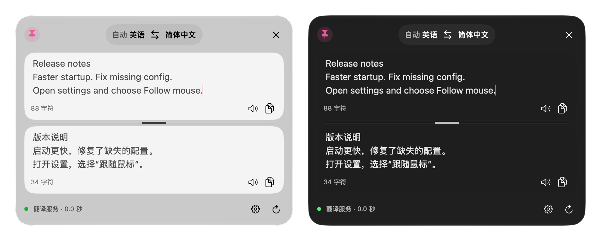

# Alex

原生 macOS 划词翻译：在任意应用里选中文字按一下快捷键，Alex 在浮动面板里用你自己的 OpenAI 兼容服务翻译。

A native macOS selection translator that uses your own OpenAI-compatible service. The interface is in Chinese.



- 纯 Swift（SwiftUI + AppKit），没有第三方依赖，常驻菜单栏，不占 Dock。
- 读不到选中文字的应用（例如微信）会临时发送一次 ⌘C 取词，读完把剪贴板原样恢复；仍读不到时翻译剪贴板里的文字。
- 流式显示译文；单词按词典格式解释，只有真实读到所在句子时才讲语境。
- 原文和译文之间的分隔条可拖动；面板位置、大小和比例都会记住。
- 出问题时可一键导出诊断报告，报告里不含原文、译文和密钥。

## 系统要求

- macOS 26 或更高版本。
- Apple Silicon 或 Intel Mac（通用二进制；目前只在 Apple Silicon 上实测过）。
- 一个 OpenAI Chat Completions 兼容、支持流式返回的服务，以及它的 API Key。

## 安装

1. 从 [Releases](../../releases/latest) 下载 `Alex-<版本>.dmg`，需要的话用同页给出的 SHA-256 核对：`shasum -a 256 Alex-0.1.0.dmg`
2. 双击打开 DMG，把 Alex 拖到旁边的 Applications 文件夹。
3. 首次打开时按下一节处理。

### 首次打开

Alex 只做了临时签名（ad-hoc），没有经过 Apple 公证，所以第一次打开会被系统拦下，提示无法验证开发者。任选一种方法放行：

- **系统设置**：先双击 Alex 一次让系统拦下，然后打开“系统设置 → 隐私与安全性”，在页面底部找到 Alex 的提示，点“仍要打开”并输入登录密码。旧版 macOS 可以“右键 → 打开”，但从 macOS 15 开始这个办法不再能绕过检查。
- **终端**：去掉下载时系统加上的隔离标记，之后就能正常双击打开：

  ```sh
  xattr -dr com.apple.quarantine /Applications/Alex.app
  ```

如果你想自己重新签名（例如改过应用包里的文件），用临时签名即可，也可以把 `-` 换成你自己的证书名称：

```sh
codesign --force --deep -s - /Applications/Alex.app
```

由于没有固定的开发者签名，每次更新后系统都把 Alex 当作新应用：可能需要重新允许辅助功能权限（在列表里先删掉旧的 Alex 再添加），读取 API Key 时钥匙串也可能再询问一次。

### 第一次使用

1. 点菜单栏的 Alex 图标，右键菜单里打开“设置…”，在“服务”页填写接口地址（默认 `https://api.openai.com/v1`）、模型名称和 API Key。可以点“测试连接”确认。
2. 划词翻译需要辅助功能权限：在“系统设置 → 隐私与安全性 → 辅助功能”里允许 Alex。没授权时仍可用输入翻译。

## 使用

Hyper 表示同时按 Control、Option、Shift、Command。

- **Hyper+D 划词翻译**：读取当前应用选中的文字并翻译。读不到时依次尝试：向前台应用发送一次 ⌘C，读完把剪贴板原样恢复（“取词失败时自动复制选中文字”，默认开）；再翻译剪贴板的第一项文字（“没有选中文字时翻译剪贴板”，默认开）。剪贴板为空或不是文字时只提示，不发请求。
- **Hyper+T 输入翻译**：Enter 翻译，Shift+Enter 换行，Esc 关闭。
- 两个快捷键都能在设置里重新录制。系统先处理的组合无法录制，其他应用占用的组合也不一定能检测到。
- 面板可以拖动空白处移动；分隔条可上下拖动调整原文和译文的高度。“面板出现在”可选“选中文字下方”“跟随鼠标”“屏幕中央”“上次的位置”；选“上次的位置”时，如果原来的显示器已经断开，面板会移回能看到的屏幕。
- 语言名称打开菜单，切换后自动重新翻译；翻译中可以停止，失败可以重试。“渲染 Markdown”开关（默认关）控制译文是否按 Markdown 显示；复制按钮总是复制原始文本。
- 设置修改后立即生效。提示词可以使用 `{原文语言}`、`{目标语言}`、`{原文}`、`{所在句子}` 四个变量。

## 隐私

- API Key 只保存在本机钥匙串，不写进设置文件、日志或报告。
- 选中的文字和所在句子只发给你配置的服务；Alex 没有统计或遥测。原文和上下文作为独立的 JSON 数据发送，不会拼进系统提示词。
- “所在句子”只取辅助功能真实读到、且与选区匹配的句子；读不到时按通用词义翻译，不编造上下文。

## 诊断日志

Alex 把关键事件写进 `~/Library/Logs/alex/events.jsonl`：取词结果和失败原因；翻译请求的开始、首字、完成、超时、出错和取消；主线程卡住超过 2 秒的记录，同时用系统的 `sample` 把调用栈存到 `stacks/`；以及正常退出。日志只记事件名和数字（字数、毫秒、错误码），不记原文、译文、密钥或服务地址。单个文件满 512 KB 就换新文件，最多保留 4 个；调用栈最多保留 6 份，超过 7 天自动删除。

遇到问题时，在菜单栏右键菜单或“设置 → 通用 → 诊断”里点“导出诊断报告…”。下载文件夹里会生成 `alex-diagnostics-<时间>.zip`，Finder 会自动选中它。压缩包里有日志、调用栈、版本号、系统版本，以及最近 7 天内系统为 Alex 记录的崩溃或卡顿报告。

## 从源码构建

需要 macOS 26 和 Xcode 26 或更新版本（Swift 6.2 及以上），以及 Python 3。

```sh
git clone https://github.com/arvakme/alex-mac.git
cd alex-mac
make build        # 生成 build/Alex.app（通用二进制）
open build/Alex.app
make verify       # 模块边界检查和测试
make dmg          # 生成 dist/Alex-<版本>.dmg 及其 SHA-256
```

`make build` 会在本机只有一个 Apple Development 证书时用它签名，否则用临时签名；设置 `ALEX_SIGN_IDENTITY` 可以指定签名身份（`-` 表示临时签名）。`make dmg` 总是用临时签名，并借助 Finder 排好 DMG 窗口，所以要在已登录的桌面会话里运行，第一次运行时系统可能会询问是否允许控制 Finder。

## 许可

[MIT](LICENSE)
